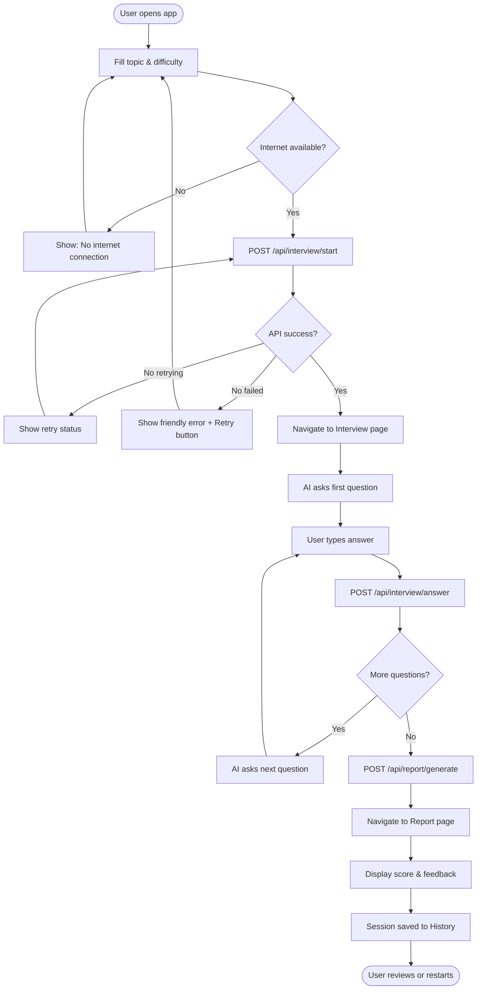
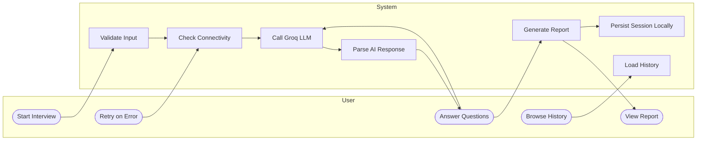

# 🎙️ AI Interview Coach

An AI-powered mock interview application that conducts technical interviews, gives real-time feedback, and stores your session history — powered by **Groq LLM**, **FastAPI**, and **Next.js**.

[](https://interview-couch.vercel.app)
[](https://interview-couch-api.onrender.com)


🌐 **Live Application:** [https://interview-couch.vercel.app](https://interview-couch.vercel.app)  
⚡ **Production Backend API:** [https://interview-couch-api.onrender.com](https://interview-couch-api.onrender.com)

---

## ✨ Features

- 🤖 **AI-Powered Interviewer** — realistic multi-turn interview conversations via Groq LLM
- 🎯 **Topic & Difficulty Selection** — customise by topic and level (Easy / Medium / Hard)
- 📊 **Detailed Reports** — AI-generated performance reports with scores and feedback
- 📚 **Interview History** — review all past sessions from the left drawer
- 🌐 **Offline Detection** — clear error shown when internet is unavailable
- 🔁 **Auto-Retry** — automatic retry with visible progress on transient failures

---

## 🏗️ Architecture Overview

```
┌──────────────────────────────────────────────────┐
│                  Client Browser                  │
│                                                  │
│  ┌─────────────────┐    ┌─────────────────────┐  │
│  │   Home Page     │───▶│   Interview Page    │  │
│  │  (topic setup)  │    │  (multi-turn chat)  │  │
│  └─────────────────┘    └──────────┬──────────┘  │
│                                    │              │
│                          ┌─────────▼──────────┐  │
│                          │    Report Page      │  │
│                          │ (score + feedback)  │  │
│                          └────────────────────-┘  │
└────────────────────┬─────────────────────────────┘
                     │  REST API (JSON/HTTPS)
                     │
┌────────────────────▼─────────────────────────────┐
│               FastAPI Backend                    │
│                                                  │
│  POST /api/interview/start                       │
│  POST /api/interview/answer                      │
│  POST /api/report/generate                       │
│                                                  │
│  ┌────────────────────────────────────────────┐  │
│  │             LLM Service                    │  │
│  │  (Groq client · prompt engineering)        │  │
│  └───────────────────┬────────────────────────┘  │
└──────────────────────┼───────────────────────────┘
                       │  HTTPS
                       │
            ┌──────────▼──────────┐
            │   Groq Cloud API    │
            │  llama-3.3-70b      │
            └─────────────────────┘
```

---

## 🔄 Flow Diagram



---

## 👤 Use Case Diagram



---

## 🧩 Class Diagram


---

## 📁 Project Structure

```
Interview-couch-/
├── backend/
│   ├── .env.example          # Environment variable template
│   ├── main.py               # FastAPI app entry point
│   ├── schemas.py            # Request / response models
│   ├── requirements.txt
│   ├── routers/
│   │   ├── interview.py      # /api/interview endpoints
│   │   └── report.py         # /api/report endpoint
│   ├── services/
│   │   └── llm_service.py    # Groq LLM integration
│   └── tests/
│       ├── unit/
│       └── integration/
│
└── frontend/
    ├── .env.local.example    # Environment variable template
    ├── src/
    │   ├── app/
    │   │   ├── page.tsx          # Home — topic & difficulty setup
    │   │   ├── interview/        # Multi-turn interview chat
    │   │   └── report/           # Performance report
    │   ├── components/
    │   │   └── history-drawer.tsx
    │   └── lib/
    │       ├── network.ts         # Retry + offline detection
    │       └── history-storage.ts # localStorage persistence
    └── package.json
```

---

## 🚀 Getting Started

### Prerequisites

| Tool | Min Version |
|------|------------|
| Python | 3.11+ |
| Node.js | 18+ |
| npm | 9+ |
| Groq API Key | [Get free key →](https://console.groq.com/keys) |

### 1. Clone

```bash
git clone https://github.com/ankit2610ak/Interview-couch-.git
cd Interview-couch-
```

### 2. Backend

```bash
cd backend
python3 -m venv venv
source venv/bin/activate        # Windows: venv\Scripts\activate
pip install -r requirements.txt

cp .env.example .env
# Open .env and set your GROQ_API_KEY

uvicorn main:app --reload --port 8000
```

API running at **http://localhost:8000**

### 3. Frontend *(new terminal)*

```bash
cd frontend
npm install
cp .env.local.example .env.local
npm run dev
```

App running at **http://localhost:3000** 🎉

---

## 🔑 Environment Variables

### `backend/.env`

| Variable | Required | Description |
|----------|----------|-------------|
| `GROQ_API_KEY` | ✅ | Groq API key — [console.groq.com/keys](https://console.groq.com/keys) |
| `GROQ_MODEL` | ❌ | Model name (default: `openai/gpt-oss-120b`) |
| `CORS_ORIGINS` | ❌ | Comma-separated allowed frontend origins |

### `frontend/.env.local`

| Variable | Required | Description |
|----------|----------|-------------|
| `NEXT_PUBLIC_API_URL` | ❌ | Backend URL (default: `http://localhost:8000`) |

---

## ☁️ Deployment

### Production Setup: Vercel + Render (Free Tier)

**Backend → Render (Web Service)**
1. Go to [dashboard.render.com](https://dashboard.render.com) → **New** → **Web Service**
2. Connect your GitHub repository `ankit2610ak/Interview-couch-`
3. Configure settings:
   - **Root Directory:** `backend`
   - **Environment:** `Python 3`
   - **Build Command:** `pip install -r requirements.txt`
   - **Start Command:** `uvicorn main:app --host 0.0.0.0 --port $PORT`
4. In **Environment Variables**, add:
   - `GROQ_API_KEY` = your Groq API key
   - `GROQ_MODEL` = `openai/gpt-oss-120b`

**Frontend → Vercel**
1. Go to [vercel.com](https://vercel.com) → **Add New** → **Project** → Import `ankit2610ak/Interview-couch-`
2. Set **Root Directory** to `frontend`
3. In **Environment Variables**, add:
   - `NEXT_PUBLIC_API_URL` = your Render backend URL (e.g., `https://interview-couch-api.onrender.com`)
   - Type: **Config** (not Secret)
4. Click **Deploy**

---

## 🤝 Contributing

1. Fork the repo and create a branch: `git checkout -b feature/my-feature`
2. Commit your changes: `git commit -m "feat: description"`
3. Push and open a Pull Request

---

## 📄 License

MIT © 2024
