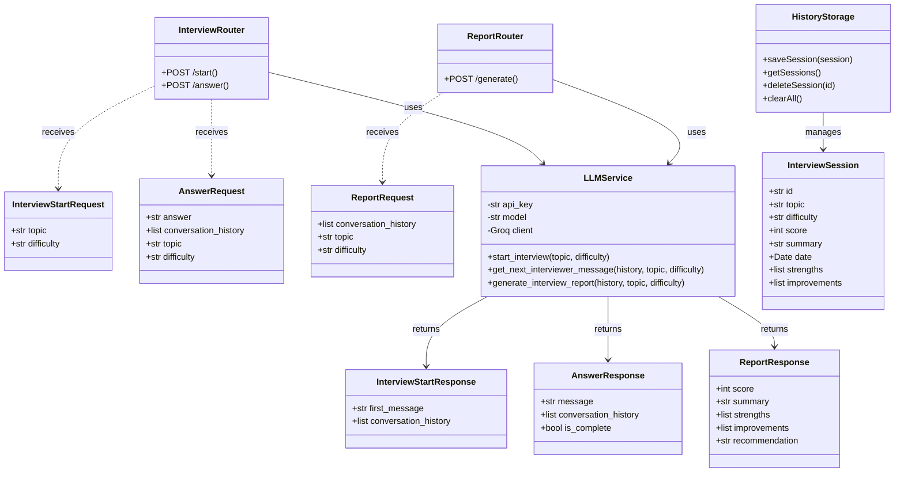

# 🎙️ AI Interview Coach

An AI-powered mock interview application that conducts technical interviews, gives real-time feedback, and stores your session history — powered by **Groq LLM** (llama-3.3-70b), **FastAPI**, and **Next.js**.


---

## 📋 Table of Contents

- [Features](#-features)
- [Architecture Overview](#-architecture-overview)
- [Flow Diagram](#-flow-diagram)
- [Use Case Diagram](#-use-case-diagram)
- [Class Diagram](#-class-diagram)
- [Project Structure](#-project-structure)
- [Local Setup](#-local-setup)
- [Environment Variables](#-environment-variables)
- [Running Tests](#-running-tests)
- [Deployment Guide](#-deployment-guide)
- [Security Notes](#-security-notes)

---

## ✨ Features

- 🤖 **AI-Powered Interviewer** — realistic multi-turn interview conversations via Groq LLM
- 🎯 **Topic & Difficulty Selection** — customise interviews by topic and level (Easy / Medium / Hard)
- 📊 **Detailed Reports** — AI-generated performance reports with scores and feedback
- 📚 **Interview History** — persist and review past sessions locally in the browser
- 🌐 **Offline Detection** — instant error message when internet is unavailable
- 🔁 **Auto-Retry** — transparent retry mechanism with user-facing progress
- 🔒 **Secret-Safe** — no secrets committed; API key stays in `.env` (gitignored)

---

## 🏗️ Architecture Overview

```
┌─────────────────────────────────────────────────────────────┐
│                       Client Browser                        │
│                                                             │
│  ┌───────────────────┐        ┌────────────────────────┐   │
│  │  Home Page        │        │  Interview Page         │   │
│  │  (topic setup)    │──────▶│  (multi-turn chat)      │   │
│  └───────────────────┘        └────────────┬───────────┘   │
│                                            │                │
│                                  ┌─────────▼──────────┐    │
│                                  │  Report Page        │    │
│                                  │  (score + feedback) │    │
│                                  └────────────────────-┘    │
└─────────────────────────┬───────────────────────────────────┘
                          │  HTTPS / REST API
                          │
┌─────────────────────────▼───────────────────────────────────┐
│                     FastAPI Backend                          │
│                                                             │
│  POST /api/interview/start   ─── starts a new session       │
│  POST /api/interview/answer  ─── submits user answer        │
│  POST /api/report/generate   ─── generates final report     │
│                                                             │
│  ┌─────────────────────────────────────────────────────┐   │
│  │                  LLM Service                         │   │
│  │  (groq client · prompt engineering · response parse) │   │
│  └───────────────────────┬─────────────────────────────┘   │
└──────────────────────────┼──────────────────────────────────┘
                           │  HTTPS
                           │
                ┌──────────▼──────────┐
                │   Groq Cloud API    │
                │  llama-3.3-70b      │
                └─────────────────────┘
```

---

## 🔄 Flow Diagram


---

## 👤 Use Case Diagram


---

## 🧩 Class Diagram



---

## 📁 Project Structure

```
Interview couch/
├── .gitignore                        # Root-level gitignore
├── README.md                         # This file
│
├── backend/
│   ├── .env                          # ⚠️ Gitignored — local secrets only
│   ├── .env.example                  # ✅ Safe to commit — template
│   ├── .gitignore
│   ├── main.py                       # FastAPI app + CORS + exception handler
│   ├── schemas.py                    # Pydantic request/response models
│   ├── requirements.txt              # Production dependencies
│   ├── requirements-dev.txt          # Dev/test dependencies
│   ├── pytest.ini
│   ├── routers/
│   │   ├── interview.py              # /api/interview/start & /answer endpoints
│   │   └── report.py                 # /api/report/generate endpoint
│   ├── services/
│   │   └── llm_service.py            # Groq LLM integration & prompt engineering
│   └── tests/
│       ├── unit/                     # Unit tests (no network calls)
│       └── integration/              # Live API tests (skip without real key)
│
└── frontend/
    ├── .env.local                    # ⚠️ Gitignored — local config only
    ├── .env.local.example            # ✅ Safe to commit — template
    ├── .gitignore
    ├── next.config.mjs
    ├── package.json
    └── src/
        ├── app/
        │   ├── page.tsx              # Home page — topic/difficulty setup
        │   ├── layout.tsx
        │   ├── globals.css
        │   ├── interview/page.tsx    # Interview chat page
        │   └── report/page.tsx       # Report + score page
        ├── components/
        │   ├── history-drawer.tsx    # Left-drawer with past sessions
        │   ├── network-status-banner.tsx
        │   └── ui/                  # shadcn/ui components
        └── lib/
            ├── network.ts            # fetchWithRetry + offline detection
            ├── history-storage.ts    # localStorage interview history
            └── utils.ts              # Shared utilities + error messages
```

---

## 🚀 Local Setup

### Prerequisites

| Tool | Min Version |
|------|------------|
| Python | 3.11+ |
| Node.js | 18+ |
| npm | 9+ |

### 1. Clone the repository

```bash
git clone https://github.com/ankit2610ak/Interview-couch-.git
cd "Interview-couch-"
```

### 2. Backend setup

```bash
cd backend

# Create virtual environment
python3 -m venv venv
source venv/bin/activate          # Windows: venv\Scripts\activate

# Install dependencies
pip install -r requirements-dev.txt

# Configure secrets
cp .env.example .env
# Edit .env — paste your real Groq API key
# Get a free key: https://console.groq.com/keys

# Start the API server
uvicorn main:app --reload --port 8000
```

Backend is now running at **http://localhost:8000**

### 3. Frontend setup (new terminal)

```bash
cd frontend

# Install dependencies
npm install

# Configure environment
cp .env.local.example .env.local
# Edit .env.local if your backend runs on a different port

# Start the dev server
npm run dev
```

Frontend is now running at **http://localhost:3000**

---

## 🔑 Environment Variables

### Backend — `backend/.env`

| Variable | Required | Default | Description |
|----------|----------|---------|-------------|
| `GROQ_API_KEY` | ✅ | — | Your Groq API key from console.groq.com/keys |
| `GROQ_MODEL` | ❌ | `llama-3.3-70b-versatile` | Groq model to use |

### Frontend — `frontend/.env.local`

| Variable | Required | Default | Description |
|----------|----------|---------|-------------|
| `NEXT_PUBLIC_API_URL` | ❌ | `http://localhost:8000` | Backend API base URL |

> **Security:** Both `.env` and `.env.local` are gitignored and never committed. Use the `.example` templates to configure fresh environments.

---

## 🧪 Running Tests

```bash
cd backend
source venv/bin/activate

# Run all tests (37 pass, 1 skipped without real API key)
pytest -v

# Run only unit tests (no API key needed)
pytest tests/unit/ -v

# Run integration tests (requires valid GROQ_API_KEY in .env)
pytest tests/integration/ -v
```

---

## ☁️ Deployment Guide

### Option A — Vercel (Frontend) + Railway (Backend) ✅ Recommended

#### Backend on Railway

1. Push code to GitHub (see instructions below)
2. Go to [railway.app](https://railway.app) → New Project → Deploy from GitHub
3. Select the repository, set **Root Directory** to `backend`
4. Add environment variables in Railway dashboard:
   - `GROQ_API_KEY` = your real Groq key
   - `GROQ_MODEL` = `llama-3.3-70b-versatile`
5. Railway auto-detects Python; add a start command: `uvicorn main:app --host 0.0.0.0 --port $PORT`
6. Note your Railway public URL (e.g. `https://your-app.railway.app`)

#### Frontend on Vercel

1. Go to [vercel.com](https://vercel.com) → New Project → Import from GitHub
2. Set **Root Directory** to `frontend`
3. Add environment variable:
   - `NEXT_PUBLIC_API_URL` = your Railway backend URL (no trailing slash)
4. Click **Deploy** — Vercel handles the Next.js build automatically

---

### Option B — Single VPS (DigitalOcean / EC2 / Render)

```bash
git clone https://github.com/ankit2610ak/Interview-couch-.git
cd "Interview-couch-"

# Backend
cd backend
python3 -m venv venv && source venv/bin/activate
pip install -r requirements.txt
cp .env.example .env && nano .env   # paste your GROQ_API_KEY

pip install gunicorn
gunicorn main:app -w 2 -k uvicorn.workers.UvicornWorker --bind 0.0.0.0:8000

# Frontend (separate terminal)
cd ../frontend
cp .env.local.example .env.local
# Set NEXT_PUBLIC_API_URL to your backend domain
npm install && npm run build
npm start   # runs on port 3000
```

Use **Nginx** as a reverse proxy to serve both on ports 80/443.

---

## 🔒 Security Notes

| Concern | How it's handled |
|---------|-----------------|
| API key exposure | `backend/.env` is gitignored at root level |
| Reverse-engineering | `GROQ_API_KEY` lives **only on the server**; frontend never receives it |
| Frontend env | `NEXT_PUBLIC_API_URL` is a URL, not a secret |
| Template files | `.env.example` / `.env.local.example` contain only placeholder values |
| CORS | Restrict `allow_origins` to your frontend domain in production |

---

## 🤝 Contributing

1. Fork the repository
2. Create a feature branch: `git checkout -b feature/my-feature`
3. Commit changes: `git commit -m "feat: add my feature"`
4. Push: `git push origin feature/my-feature`
5. Open a Pull Request

---

## 📄 License

MIT © 2024 — free to use, modify, and distribute.
